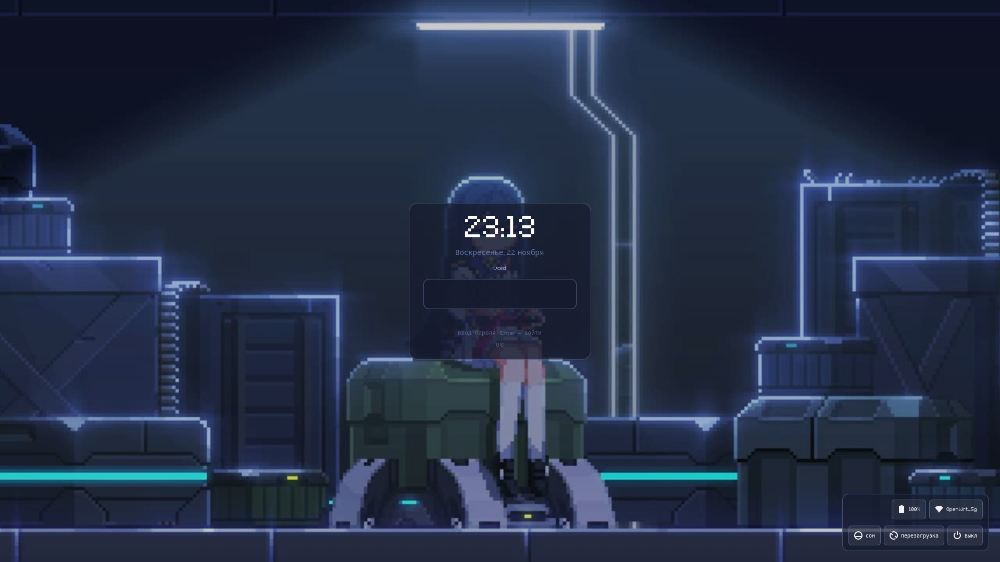
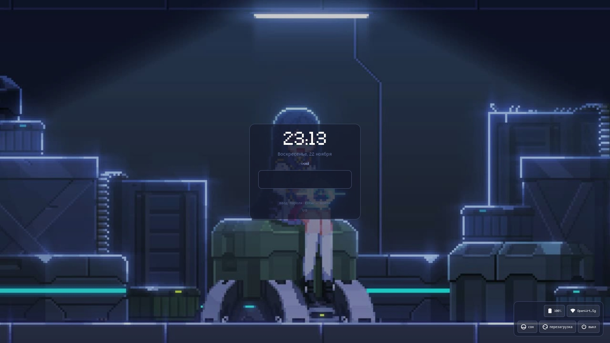

# videolock

Wayland **session lock** for Hyprland: GTK4 + `Gtk4SessionLock` + PAM, with an animated JPEG (or optional video) background.

<p align="center">
  
</p>

<p align="center">
  
  &nbsp;
  <a href="assets/screenshots/lock.mp4">▶ lock screen clip (5s)</a>
</p>

```bash
git clone https://github.com/torwin-job/videolock.git
cd videolock
./install.sh --video ~/Pictures/wall.mp4 --hypridle
```

Then bind Super+L (see [`examples/`](examples/)) and lock.

## Features

- Real `ext-session-lock-v1` (not a fake fullscreen window)
- PAM auth for the current user, exponential backoff on failure
- Singleton (`flock`), secure cache log (`0600`)
- Default background: JPEG frame strip (reliable under session-lock)
- Optional `VIDEOLOCK_GST=1` for experimental `Gtk.Video`
- XDG paths, no hardcoded usernames/themes in core
- Battery + network status; Sleep / Reboot / Power buttons
- Wallbash accent colors from HyDE wallpaper palette
- Pixelon UI (matches SDDM Astronaut)

## Dependencies

| Package | Notes |
|---------|--------|
| Python 3.11+ | |
| `python-gobject`, GTK4 | |
| `gtk4-session-lock` | provides `Gtk4SessionLock` |
| `python-pam` | required or lock will refuse to arm |
| `ffmpeg` | only for `prepare-assets` / `--video` |

**Arch example:**

```bash
sudo pacman -S python python-gobject gtk4 python-pam ffmpeg
# gtk4-session-lock from AUR / your Hyprland stack
```

## Install

```bash
./install.sh                     # binaries → ~/.local/bin
./install.sh --video wall.mp4    # + generate poster/frames/video into XDG data
./install.sh --hypridle          # patch ~/.config/hypr/hypridle.conf
./uninstall.sh                   # remove binaries (keep assets)
./uninstall.sh --purge-data      # also delete ~/.local/share/videolock
```

Self-check:

```bash
videolock --check
videolock --version
```

## Configure compositor

**hypridle** — [`examples/hypridle.conf`](examples/hypridle.conf):

```
$LOCK_CMD = $HOME/.local/bin/videolock.sh
$UNLOCK_CMD = $HOME/.local/bin/videolock-unlock.sh
```

**Keybind** — one path only (avoid Super+L → loginctl *and* a second direct bind):

- Classic: [`examples/hyprland.conf`](examples/hyprland.conf)
- HyDE Lua: [`examples/hyprland.lua`](examples/hyprland.lua)

## Assets & environment

| Path / env | Purpose |
|------------|---------|
| `~/.local/share/videolock/poster.png` | Still shown until frames start |
| `~/.local/share/videolock/frames/f-*.jpg` | Default animated background |
| `~/.local/share/videolock/video.mp4` | Optional / Gst mode |
| `VIDEOLOCK_VIDEO` / `POSTER` / `FRAMES` | Override paths |
| `VIDEOLOCK_GST=1` | Try live video under lock |
| `VIDEOLOCK_LANG=en\|ru` | UI language (default: locale) |
| `VIDEOLOCK_FONT=…` | CSS font (default: **Pixelon**, same as SDDM Astronaut) |
| `VIDEOLOCK_RESET_LAYOUT=0` | disable auto-reset to primary layout on lock |
| `VIDEOLOCK_SCALE=1.25` | force UI scale (default: monitor scale × density) |
| `VIDEOLOCK_DENSITY=0.95` | shrink/grow panel vs monitor scale (default 0.95) |

On lock, videolock **resets the keyboard to layout 0** (usually `us`) and shows `US`/`RU` + `CAPS` on the panel. Use `bindl` (or Lua `locked = true`) for layout hotkeys — see `examples/`.

### Battery / network / power

Battery and Wi‑Fi/Ethernet sit as separate icon chips in a **bottom-right** corner dock, with **sleep / reboot / power** buttons underneath (`systemctl`). Center panel stays focused on unlock.

Colors follow HyDE **wallbash** (`~/.cache/hyde/wall.dcol`) when present. Disable with `VIDEOLOCK_WALLBASH=0`.

### Crash recovery

If the locker dies without a clean `unlock()` (Hyprland crash-lock overlay):

```bash
videolock --recover
# or
videolock-unlock.sh --recover
```

### Install tips (avoid dual Super+L)

```bash
./install.sh --hypridle --bind
```

`--hypridle` backups `hypridle.conf` first. `--bind` installs one Super+L → `videolock.sh` path and comments competing `loginctl lock-session` binds.

Prepare manually:

```bash
videolock-prepare-assets --video ~/wall.mp4
```

## Project layout

```
bin/           # videolock, wrappers
scripts/       # prepare-assets, warm-video
examples/      # hypridle / hyprland snippets
contrib/hyde/  # optional wallpaper & personal HyDE glue
docs/          # architecture + audits
install.sh
```

See [`docs/ARCHITECTURE.md`](docs/ARCHITECTURE.md) and [`docs/AUDIT.md`](docs/AUDIT.md).

## Security

Threat model and reporting: [`SECURITY.md`](SECURITY.md).  
Session lock is **not** full-disk encryption.

## License

MIT — see [`LICENSE`](LICENSE).
